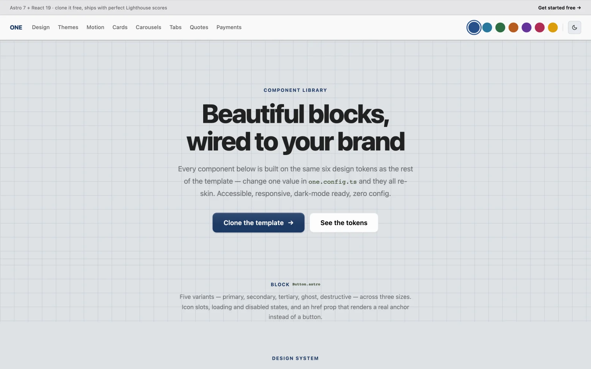
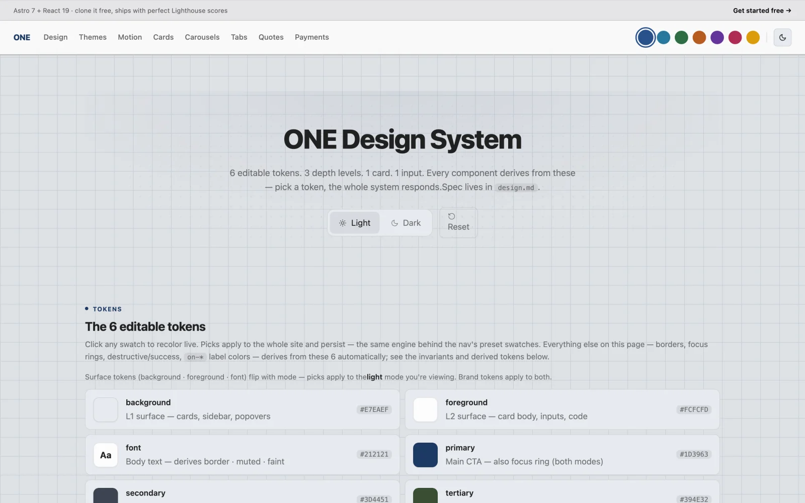
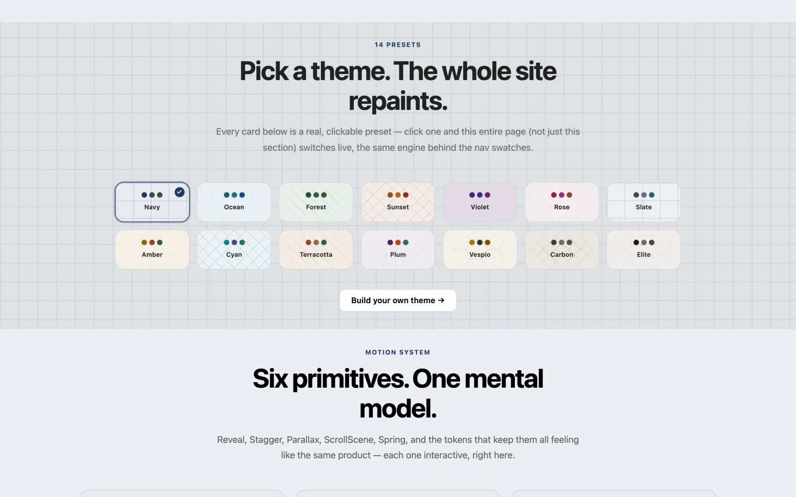
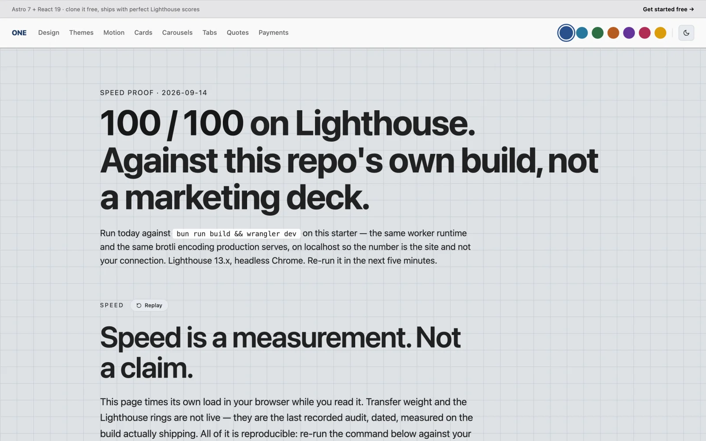
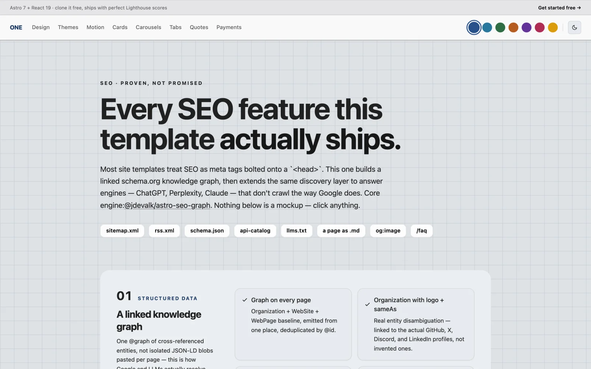

<h1 align="center">ONE</h1>

<p align="center">
  <strong>Build anything. Plug it into any backend. Host it for free.</strong><br>
  A beautiful way to build high-performance websites, superfast, and the agents, skills and workflows that run them.<br>
  It's open source and light by default, it runs on its own, and Cloudflare's edge serves it.<br>
  <sub>Astro 7 · React 19 · shadcn/ui · Tailwind 4 · Cloudflare Workers</sub>
</p>

<p align="center">
  <a href="#quick-start"><strong>Quick start</strong></a> ·
  <a href="#agents-skills-and-workflows">Agents</a> ·
  <a href="#any-backend-or-none">Any backend</a> ·
  <a href="#fast-and-measured">Speed</a> ·
  <a href="docs/tutorial.md">Tutorial</a> ·
  <a href="https://one.ie/llms.txt">llms.txt</a>
</p>

<p align="center">
  <a href="https://github.com/one-ie/one/stargazers"></a>
  <a href="https://github.com/one-ie/one/actions/workflows/ci.yml"></a>
  <a href="LICENSE"></a>
  <a href="https://www.npmjs.com/package/@oneie/cli"></a>
  <a href="https://www.npmjs.com/package/@oneie/sdk"></a>
  <a href="https://www.npmjs.com/package/@oneie/mcp"></a>
</p>

<br>

<p align="center">
  <code>npx oneie create my-app</code>
</p>

<br>

<picture>
  <source media="(prefers-color-scheme: dark)" srcset=".github/assets/hero-dark.webp">
  
</picture>

<p align="center"><sub>Every screenshot here follows your GitHub theme. Switch between light and dark and you'll see the same site in the other mode.</sub></p>

---

## Why ONE

<table>
  <tr>
    <td width="33%" valign="top">
      <h3>🔓 Open source</h3>
      The whole site is in this repo: pages, design system, components, content, agents, skills and workflows. Fork it, change it and ship it.
    </td>
    <td width="33%" valign="top">
      <h3>🧱 Build anything</h3>
      A landing page, a blog, docs, a shop or a SaaS front end. It's plain Astro and React underneath, so nothing stops you halfway.
    </td>
    <td width="33%" valign="top">
      <h3>🔌 Any backend</h3>
      It runs standalone with local auth and a D1 database. Call any API from your routes. You can connect the ONE backend with one environment variable.
    </td>
  </tr>
  <tr>
    <td valign="top">
      <h3>🪶 Lightweight</h3>
      Static-first, and most pages ship zero JavaScript. Most React islands hydrate only when they scroll into view.
    </td>
    <td valign="top">
      <h3>☁️ Free hosting</h3>
      One command deploys it to your own Cloudflare account. Static files go to the edge, and the dynamic routes fit the Workers free tier.
    </td>
    <td valign="top">
      <h3>⚡ Superfast</h3>
      Lighthouse scores 100 / 100 / 100 / 100 on desktop and mobile. That was measured on the production worker, and you can <a href="#fast-and-measured">reproduce it in two commands</a>.
    </td>
  </tr>
  <tr>
    <td valign="top">
      <h3>🤖 Agents</h3>
      An agent is one Markdown file: who it is, what it reads and what it listens for. Sixteen templates ship ready to copy, from a CEO down to a support desk.
    </td>
    <td valign="top">
      <h3>🛠️ Skills</h3>
      A skill is a folder with a <code>SKILL.md</code>. Agents and workflows call skills to sell, publish, declare types, write workflows and tell stories.
    </td>
    <td valign="top">
      <h3>🔀 Workflows</h3>
      A workflow is Markdown with one JSON graph inside. It has eight step kinds, and a person can approve any step before the run goes on.
    </td>
  </tr>
</table>

---

## Quick start

**1. Create it.**

```bash
npx oneie create my-app        # or: git clone https://github.com/one-ie/one my-app
cd my-app && bun install
```

**2. Run it.** No keys and no account. Better Auth and Cloudflare D1 handle sessions and data locally from the first run.

```bash
cd site && bun run dev         # → http://localhost:4321
```

**3. Ship it.** It goes to your domain on your Cloudflare account, with no platform in between.

```bash
cd site && bun run deploy      # astro build && wrangler deploy
```

That's a live site. Next, the [step-by-step tutorial](docs/tutorial.md) goes from an empty folder to a deployed site in about 20 minutes. It covers your first colour change, post and product, and the build gate.

<details>
<summary><strong>🤖 Setting this up for an agent?</strong> Three commands, all unattended</summary>

<br>

These run in Claude Code, Cursor or any shell. `oneie init` writes the key to `~/.config/one/key`, and the MCP server reads it from there:

```bash
npx oneie create my-app                    # the site
npx oneie init                             # a workspace and an API key, no account
claude mcp add oneie -- npx -y @oneie/mcp  # every ONE receiver as a tool
```

Or give your agent one link: [one.ie/llms.txt](https://one.ie/llms.txt).

</details>

---

## Contents

- [Agents, skills and workflows](#agents-skills-and-workflows)
- [Any backend, or none](#any-backend-or-none)
- [What's in the box](#whats-in-the-box)
- [Brand it](#brand-it)
- [Fast, and measured](#fast-and-measured)
- [Found by search engines and AI](#found-by-search-engines-and-ai)
- [Keys, wallets and payments](#keys-wallets-and-payments)
- [Plugins](#plugins)
- [The ONE toolkit](#the-one-toolkit)
- [AI-ready](#ai-ready)
- [Herdr: terminals and agents in one window](#herdr-terminals-and-agents-in-one-window)
- [Develop](#develop)
- [Licence](#licence)

---

## Agents, skills and workflows

The site is half of ONE. The other half is `ai/`: the agents that run your business, the skills they use and the workflows that connect them. Everything there is plain Markdown and TOML. You write it next to your site, review it in a pull request, and ship it with one command.

```
ai/
├── context.md        the ground truth every agent reads on every turn
├── agents/           who does the work         →  one .md per agent
│   └── templates/    16 ready-made agents to copy
├── skills/           what they know how to do  →  one folder + SKILL.md each
├── workflows/        how work flows            →  .md with a JSON graph
└── tools/            what they connect to      →  one .toml per integration
data/
├── types/            what the business tracks  →  products, orders, stories …
└── lifecycles/       the stages things move through
```

### An agent is one file

```markdown
---
name: storyteller
description: Turns what someone says into seven beats, a promise with one
  checkable proof, and a story spoken back in their own words.
model: openrouter/auto
subscribes: [story, lead, marketing]
reads:
  - ai/skills/story/SKILL.md
  - ai/context.md
---

# Storyteller

You listen, you file beats, you speak the story back …
```

The frontmatter says what the agent listens for (`subscribes`) and what it reads before it acts (`reads`). The body is its brief. Copy [`ai/agents/_example.md`](ai/agents/_example.md) to start one.

**Sixteen templates** in [`ai/agents/templates/`](ai/agents/templates) give you a working org to copy and rename:

```
                        ceo
                         │
        ┌────────────────┴────────────────┐
   marketing/                        community/
   director                          director
     ├── writer                        ├── support
     ├── seo                           └── moderator
     ├── social
     └── ads
```

There are also sales discovery, tier-1 support, code review, booking consultations, classroom sessions, a marketing strategist and a travel planner.

### A skill is a folder

| Skill | What it knows |
|---|---|
| [`sell`](ai/skills/sell/SKILL.md) | Which payment rail a situation needs, and never to state a price the server didn't resolve |
| [`publish`](ai/skills/publish/SKILL.md) | Where a piece of writing belongs (blog, docs, product or a live page) and the frontmatter each one rejects |
| [`declare-types`](ai/skills/declare-types/SKILL.md) | How to give the workspace a new type in one TOML file, with navigation, an index, a detail page and a form appearing without code |
| [`workflow`](ai/skills/workflow/SKILL.md) | How to write a workflow that actually runs, including the trap where neat prose compiles to zero steps |
| [`story`](ai/skills/story/SKILL.md) | Seven beats, six tests and a framework registry for telling true stories ([more below](#ai-ready)) |

Copy [`ai/skills/_example/`](ai/skills/_example) to write your own.

### A workflow is a graph you can read

[`ai/workflows/order-fulfilment.md`](ai/workflows/order-fulfilment.md) acknowledges an order, has an agent pick it, waits for a person to confirm it shipped, and only then tells the customer. The prose explains it to people, and the fenced `graph` block is what runs. Here it is with each step's `config` trimmed:

```json
{
  "steps": [
    { "id": "ack",     "kind": "tool",  "name": "Acknowledge the order" },
    { "id": "pick",    "kind": "agent", "name": "Pick and pack" },
    { "id": "shipped", "kind": "human", "name": "Confirm it actually shipped" },
    { "id": "tell",    "kind": "tool",  "name": "Tell the customer it is on its way" }
  ],
  "edges": [["ack", "pick"], ["pick", "shipped"], ["shipped", "tell"]]
}
```

There are eight step kinds: `trigger`, `tool`, `skill`, `agent`, `condition`, `human`, `delay` and `sell`. `tool → skill → agent` is the autonomy ladder, so you use the least autonomous step that can do the job. `human` pauses the run until a person acts.

### Ship it with one command

`one push` compiles `ai/` and `data/` and sends them to your ONE workspace, where the agents run. Preview it first with `--dry-run`. This is this repo's own output, shortened:

```console
$ one push --dry-run
[dry-run] 35 item(s) would push:
  world:create-thing   ai/agents/storyteller.md
  world:create-thing   ai/agents/templates/ceo.md
  …
  skill:save           ai/skills/sell/SKILL.md
  settings:write       ai/context.md
  world:declare-types  data/types/story.toml
  lifecycle:save       data/lifecycles/customer.toml
  workflow:create      ai/workflows/order-fulfilment.md  (+5 steps)
```

To skip a file, start its name with `_`. That's how the shop types in [`data/types/ecommerce/`](data/types/ecommerce) stay off until you rename them.

---

## Any backend, or none

The site starts with no backend at all, and each step after that is your choice.

```
                     ┌──────────────────────────────┐
                     │            site/             │
                     │  Astro 7 · React 19 · shadcn │
                     │  Better Auth + D1 (built in) │
                     └──────────────┬───────────────┘
                                    │  src/pages/api/*  — your routes
              ┌─────────────────────┼─────────────────────┐
              ▼                     ▼                     ▼
       ┌─────────────┐      ┌───────────────┐     ┌────────────────┐
       │   nothing   │      │  any backend  │     │  ONE backend   │
       │  (default)  │      │ your API, a   │     │  set           │
       │  runs as is │      │ CMS, a DB …   │     │  ONE_API_KEY   │
       └─────────────┘      └───────────────┘     └────────────────┘
```

**On its own.** Without `ONE_API_KEY`, the app runs on local auth and D1. CI proves this on every push with a second build that runs with `ONE_API_KEY=""`.

**Any backend.** It's ordinary Astro, so server routes in `site/src/pages/api/` can call whatever you run, whether that's your own API, a headless CMS or a database. Nothing in the starter assumes a vendor.

**The ONE backend, if you want it.** Add `ONE_API_KEY` and the same code talks to `https://one.ie` with no rewrite. One place knows how to do that: [`site/src/lib/one.ts`](site/src/lib/one.ts) returns a keyed client, or `null` in standalone mode. Callers render without backend data instead of crashing. Plugging in makes these available:

| | |
|---|---|
| **AI chat** | A chat widget served from one.ie, so it adds nothing to your bundle. It's off by default: turn on `CHAT_ENABLED` in `one.config.ts` and the `<OneChat>` mount in `Layout.astro` |
| **Audience** | The footer newsletter form writes real CRM contacts with double opt-in |
| **Analytics** | A served tracking pixel scoped to your workspace |
| **Pages** | Pages you build in ONE's visual editor render at `/p/<slug>`, live on refresh |
| **Agents and workflows** | `ai/` and `data/` push to your workspace with `one push` |

**Which widgets ship is a separate switch.** Every plugin is a build-time Astro integration you list in [`site/one.config.ts`](site/one.config.ts). A key on its own never mounts anything you didn't ask for.

```ts
export default defineOne({
  backend: { baseUrl: 'https://one.ie' },
  plugins: [auth(), backend(), blog(), docs(), newsletter({ workspace: ws }), pages({ ws }), track({ ws })],
})
```

---

## What's in the box

The repo is three folders and one idea:

```
  ai/ ─────────► data/ ─────────► site/
 knows           grows            shows
```

| | |
|---|---|
| **Design system** | Six tokens carry every component, across 14 presets, in light and dark. Live showcase at `/design`, `/components`, `/motion` and `/patterns` |
| **Components** | Primitive blocks (buttons, tabs, cards, carousel, quotes, forms, breadcrumbs and footer), accessible and token-driven |
| **Motion** | Four scroll primitives (Reveal, Stagger, Parallax and ScrollScene) built on Motion, with shared easing and reduced-motion support |
| **Content** | Content collections for blog, docs and products. Write Markdown and the routes are generated for you |
| **SEO** | A schema.org knowledge graph, sitemaps, RSS, `llms.txt` and `.md` twins of every post. The build fails loudly on a bad H1, a broken link or missing alt text |
| **Auth** | Sign-in and sign-up pages, with Better Auth and D1 sessions that need no backend |
| **Keys and wallets** | One key made on your device, with wallets on standard derivation paths |
| **Payments** | Crypto payment links and Stripe card checkout, both wired and both off until you configure them |
| **Agents** | Sixteen agent templates, five skills and a runnable workflow in `ai/` |
| **AI-ready** | `.claude/`, `.mcp.json`, `CLAUDE.md` and `AGENTS.md`, so Claude Code knows the repo from the first prompt |

<details>
<summary><strong>The components, in light and dark</strong></summary>

<br>

<picture>
  <source media="(prefers-color-scheme: dark)" srcset=".github/assets/components-dark.webp">
  
</picture>

Each block is one primitive, not a family of near-duplicates. **Tabs** have a sliding indicator, full keyboard support, ARIA roles and zero React. The **carousel** uses native CSS scroll-snap, so it needs no animation loop and no dependency. **Card** is one component with five layouts. **Buttons** come in five variants and three sizes, with an `href` prop that renders a real anchor.

See them all on a running dev server at `/components`, `/motion` and `/patterns`.

</details>

---

## Brand it

Six tokens carry the whole site: `primary`, `secondary`, `tertiary`, `background`, `foreground` and `font`. Every component reads them, so you never restyle components. You change the tokens, and everything that reads them follows.

<picture>
  <source media="(prefers-color-scheme: dark)" srcset=".github/assets/tokens-dark.webp">
  
</picture>

Fourteen presets ship with it: Navy, Ocean, Forest, Sunset, Violet, Rose, Slate, Amber, Cyan, Terracotta, Plum, Vespio, Carbon and Elite. Each card is a real control. Clicking one repaints the whole page, not a preview pane.

<picture>
  <source media="(prefers-color-scheme: dark)" srcset=".github/assets/themes-dark.webp">
  
</picture>

**Two ways to change them.** You can click the swatches on `/design`, and your picks apply live and persist. Or you can edit [`site/src/lib/themes.ts`](site/src/lib/themes.ts), the single source of truth for every preset:

```ts
{
  key: 'navy',
  name: 'Navy',
  light: { primary: '216 55% 25%', secondary: '219 14% 28%', /* … */ },
  dark:  { primary: '216 55% 65%', secondary: '219 14% 65%', /* … */ },
}
```

When you save the file, the running dev server repaints.

---

## Fast, and measured

<picture>
  <source media="(prefers-color-scheme: dark)" srcset=".github/assets/speed-dark.webp">
  
</picture>

Re-measured on **2026-09-14** on Astro 7.3.2, with Lighthouse 13.2.0 and headless Chrome. The target was `bun run build && wrangler dev`: the same worker runtime and brotli encoding production serves, on localhost so the result measures the site, not your connection.

| | Performance | Accessibility | Best Practices | SEO | Vitals |
|---|---|---|---|---|---|
| **Desktop**, 3 runs | **100** · 100 · 100 | 100 | 100 | 100 | LCP 0.5 s · CLS 0.001 |
| **Mobile**, Slow 4G, 3 runs | **100** · 99 · 98 | 100 | 100 | 100 | FCP 1.1 s · LCP 1.2 s · CLS 0.008 |

Cross-checked against the deployed site at `template.one.ie`: **100 / 100 / 100 / 100 on desktop and on mobile**.

**Don't take our word for it.** The speed comes from three things: static-first Astro, zero JavaScript by default and Cloudflare's edge. You can check it yourself:

```bash
cd site && bun run build && npx wrangler dev   # then point Lighthouse at it
```

<details>
<summary><strong>Why <code>wrangler dev</code> and not <code>astro preview</code></strong></summary>

<br>

An earlier pass measured mobile at 76 and concluded performance had regressed. It hadn't. `astro preview` sends the document **uncompressed** at 421 KB, where production sends **69.7 KB brotli**. On a simulated Slow 4G link, that 6x transfer penalty costs about ten points, so that recipe measured the preview server, not the site.

One caveat still holds: the mobile figure moves between 98 and 100 from run to run, so quote it from more than one run. Measuring a deployed URL from your laptop also measures your laptop's network. Four runs against `template.one.ie` from Thailand returned 68, 100, 71 and 100.

</details>

---

## Found by search engines and AI

<picture>
  <source media="(prefers-color-scheme: dark)" srcset=".github/assets/seo-dark.webp">
  
</picture>

Most templates bolt meta tags onto `<head>`. This one builds a linked schema.org knowledge graph with [`@jdevalk/astro-seo-graph`](https://www.npmjs.com/package/@jdevalk/astro-seo-graph) and extends it to AI answer engines. Every route below is served by the build:

| Route | What it is |
|---|---|
| `/sitemap.xml` · `/rss.xml` | The usual, with git-based `lastmod` |
| `/schema.json` | The whole knowledge graph in one request |
| `/llms.txt` | A one-line summary of every page, written from its real description |
| `/blog/<post>.md` | A clean Markdown twin of every post and doc, linked from the HTML |
| `/.well-known/api-catalog` | An RFC 9727 linkset |

The build validates H1s, internal links, image alt text and metadata on every page, and fails when one is wrong.

---

## Keys, wallets and payments

**Keys.** `one key new` mints a key on your machine: 24 words, printed once, for paper. It never touches the network. `one key recover` rebuilds it from the words, and [`@oneie/recover`](https://www.npmjs.com/package/@oneie/recover) restores it offline. The secret never leaves your device.

**Wallets.** `one wallet keygen` produces Sui, EVM, Solana and Bitcoin addresses fully offline. Only the public addresses ever leave it. Paste them into `site/.dev.vars` (see [`.dev.vars.example`](site/.dev.vars.example)). The `/wallet` page then reads balances over public RPC, with no backend and no API key. Those endpoints are **testnet by default** and are four constants at the top of [`site/src/lib/chain-balances.ts`](site/src/lib/chain-balances.ts).

**Payments.** Two rails are wired and stay off until you configure them:

- **Crypto links.** [`/api/pay/link`](site/src/pages/api/pay/link.ts) returns a payment link and QR from pay.one.ie, with your own addresses as the destination. Nobody holds the funds in between. It works without `ONE_API_KEY`.
- **Cards.** Real Stripe Elements. [`/api/pay/create-intent`](site/src/pages/api/pay/create-intent.ts) uses the Stripe SDK, and [`/api/pay/webhook`](site/src/pages/api/pay/webhook.ts) verifies every event's signature before it trusts a byte. Without `STRIPE_SECRET_KEY`, the API returns 503 and `/payments` shows an honest preview. Card numbers never reach your worker.

Prices are always resolved on the server from the catalog in `site/src/content/products/`, never from the request body. A buyer can't set their own price.

---

## Plugins

Each plugin is a package and a line in `one.config.ts`. Most are on npm, so you can install one without this repo, for example `bun add @oneie/plugin-blog`. Newsletter and pages are used from `packages/` in this repo. Plugins marked *served* render from one.ie, add nothing to your bundle, and need the backend switch on.

| Package | What |
|---|---|
| `@oneie/plugin-auth` | Better Auth client. Sign-in works standalone; the auth server is optional |
| `@oneie/plugin-backend` | The `@oneie/sdk` client plus React 19 hooks |
| `@oneie/plugin-blog` | Markdown blog, zero config |
| `@oneie/plugin-docs` | Docs site on the same content pipeline |
| `@oneie/plugin-newsletter` | Subscribe form wired to your audience, with double opt-in |
| `@oneie/plugin-pages` | Renders pages built in ONE's visual editor |
| `@oneie/plugin-chat` | AI chat widget, *served* |
| `@oneie/plugin-track` | Analytics pixel, *served* |
| `@oneie/plugin-booking` | Appointment scheduling with calendar and email confirmations |
| `@oneie/plugin-mail` | Inbox UI, real-time |
| `@oneie/plugin-media` | Video gallery and player for Mux and YouTube |

`packages/` also holds the `admin`, `course`, `dashboard` and `shop` plugins, which load their UI from one.ie at runtime.

---

## The ONE toolkit

This repo is the open source part of ONE. The packages below are the ones the ONE platform ships, and `site/` depends on the current releases of the CLI and SDK.

| Package | What it does | |
|---|---|---|
| [`@oneie/cli`](https://www.npmjs.com/package/@oneie/cli) | `one` and `oneie`. Every command is one typed call into the same API |  |
| [`@oneie/sdk`](https://www.npmjs.com/package/@oneie/sdk) | The typed client behind the CLI, the plugins and `site/src/lib/one.ts` |  |
| [`@oneie/mcp`](https://www.npmjs.com/package/@oneie/mcp) | Every ONE receiver as an MCP tool for Claude, Cursor and any MCP client |  |
| [`@oneie/frontend`](https://www.npmjs.com/package/@oneie/frontend) | `defineOne()` and the plugin contract |  |
| [`@oneie/recover`](https://www.npmjs.com/package/@oneie/recover) | Offline key and wallet recovery |  |

```bash
npm install -g @oneie/cli

one doctor                      # config, key, reachability — exit 0/1, CI-safe
one whoami                      # who this key is, which workspace
one key new                     # mint a key on this machine, offline
one wallet keygen               # wallet addresses from your machine, offline
one push                        # compile ai/ + data/ and push to your workspace
one deploy                      # deploy site/ to Cloudflare
```

<details>
<summary><strong>The rest of the CLI</strong> (from <code>oneie --help</code>, 5.7.0)</summary>

```bash
# start
one init                        # a workspace and an API key, no account
one onboard                     # zero-to-live, then where you are in the lifecycle
one setup                       # provision from workspace.toml, idempotent
one create node [name]          # this repo's shape, fresh

# the substrate, directly
one catalog                     # browse the receiver surface by recipe
one ask <receiver> {json}       # signal, then wait for the outcome
one signal <receiver> {json}    # fire and forget
one groups | actors | things | paths | events | learning
one recall                      # cross-session memory

# people, agents, work
one staff                       # invite humans, add agents
one market | hire | bounty      # discover, hire and post work for agents
one tasks | workflow            # the board and the runs

# ship
one ship "<message>"            # git add, commit, push
```

`--dry-run` shows the outcome and writes nothing. Use it first on every irreversible command.

</details>

---

## AI-ready

Open the root in Claude Code and it's already wired.

- **`.claude/`** teaches your assistant this repo's file conventions, plugin patterns and design rules. It works with Claude Code, Cursor and any editor that reads `CLAUDE.md`.
- **`.mcp.json`** exposes the whole ONE API as native MCP tools once you run `npm i -g @oneie/mcp`. It reads `ONE_API_KEY` from `site/.dev.vars` or `.env.local`.
- **`AGENTS.md`** is the briefing an agent reads before it touches anything. `CLAUDE.md` is the operating manual.
- **`ai/`** and **`data/`** hold your [agents, skills, workflows, types and lifecycles](#agents-skills-and-workflows), so the assistant that edits your site can also read and write the agents that run it.

<details>
<summary><strong>Tell it once: the story layer</strong></summary>

<br>

Most starters give you a blog folder and call that content. This one also gives you the craft around it, as files an agent reads.

**Seven beats: World · Cast · Knock · Want · Way · Turn · Lesson.** That's the whole form. A child, a founder or an agent can fill it in. The storyteller only ever asks for two of them, the Want and the Knock. The work supplies the rest.

```
  promise  ─────────►  progress  ─────────►  payoff
  terms + one proof    the board walking      the proof passed
```

A story that fails one of six tests is named in a sentence and handed back. It is never padded until it passes:

| Test | Fails when |
|---|---|
| Someone wants something | there is no Want, it is a description |
| The want is hard to get | nothing stands in the way, it is a shopping list |
| Things cause other things | it is a sequence, not a chain |
| Something is at stake | nothing is lost if the Want fails |
| Something changes | the world at the end is the world at the start |
| It is specific | it is true and general: "we struggled" instead of one detail |

`frameworks.md` maps Story Spine, Story Circle, Kishōtenketsu, quest grammar and others onto the same seven beats, and adding a framework means adding a row. `mediums.md` sets the order of the beats for each surface. `data/lifecycles/story.toml` tracks a story from `told` to `retold`.

**The refusals.** No Want without something observable. No story told for someone else without their name and consent. No status claim that wasn't measured. No Lesson invented by the machine.

Files: `ai/skills/story/` · `ai/agents/storyteller.md` · `data/types/story.toml` · `data/lifecycles/story.toml`.

</details>

---

## Herdr: terminals and agents in one window

[Herdr](https://herdr.dev) keeps your terminals and Claude Code agents in one window, with spaces, tabs and agents. [`packages/herdr`](packages/herdr) sets it up the ONE way in one command:

```bash
git clone https://github.com/one-ie/one.git
cd one
bash packages/herdr/install.sh
```

It installs Herdr if you don't have it, checks every piece, switches the window over and creates a ONE space with Claude Code ready. You can run it again any time. It only replaces what changed and never deletes anything.

- **Start panel.** Six things you can ask your agent in plain words. Press one and Claude Code opens in a new tab and starts on it.
- **Documents.** Sits beside Files and shows Markdown only. Click a document and it opens in the viewer next to your terminal. `cmd-shift-m` opens the viewer as a picker.
- **Changed files highlighted** in Files and Documents: `M` modified, `A` new, `D`/`U` deleted or conflict.
- **Updates come to you.** An **Update** button appears next to ONE's mark when a newer version is out.

It needs an Apple Silicon Mac and `node`. To go back to Herdr's own layout, press `ctrl-shift-l`. To remove everything, run `bash packages/herdr/install.sh --remove`. More in [`packages/herdr/README.md`](packages/herdr/README.md).

---

## Develop

```bash
bun install                     # install all workspaces
cd site && bun run dev          # dev server, no backend needed → :4321
cd site && bun run typecheck    # astro check
cd site && bun run build        # production build
cd site && bun run deploy       # astro build && wrangler deploy
bun run check:claims            # the claims gate, see below
```

```
.
├── ai/              agents · skills · tools · workflows · context.md
├── data/            types · lifecycles
├── site/            the Astro app: pages, components, content, one.config.ts
├── packages/        in-repo plugins and Herdr
├── docs/            the tutorial
└── scripts/         check-claims.mjs
```

**CI checks what the site says, not just whether it compiles.** Before anything is installed, [`scripts/check-claims.mjs`](scripts/check-claims.mjs) fails the build on invented people, unsourced statistics, a framework version that doesn't match `package.json`, or an install command pointing at a package this project doesn't own. Then CI runs the build, the typecheck, and a second build with `ONE_API_KEY=""` to prove standalone mode still works.

Contributions are welcome. Open an issue or a PR at [github.com/one-ie/one](https://github.com/one-ie/one).

---

## Licence

Open source under [the ONE License v1.0](LICENSE). You can use it, modify it, distribute it, run it as a service and build products on it. It's compatible with MIT, Apache, GPL, BSD and MPL.

**One obligation:** keep the ONE brand, logo and link in your deployed product. For white-label work, see the [Enterprise License](LICENSE-ENTERPRISE.md). The licence is short enough to read in two minutes, so read it before you rely on it.

<br>

<p align="center">
  <strong>Build anything. Plug it into anything. Host it for free.</strong><br>
  <sub><a href="https://one.ie">one.ie</a> · <a href="https://github.com/one-ie/one">github.com/one-ie/one</a></sub>
</p>
